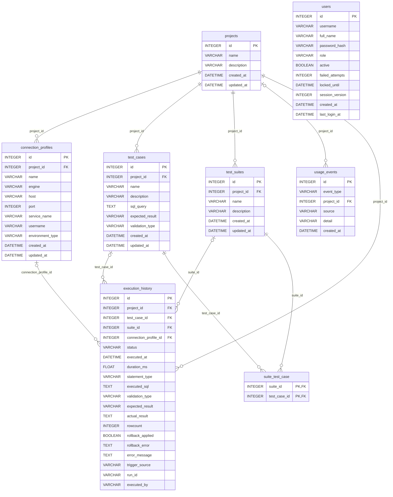
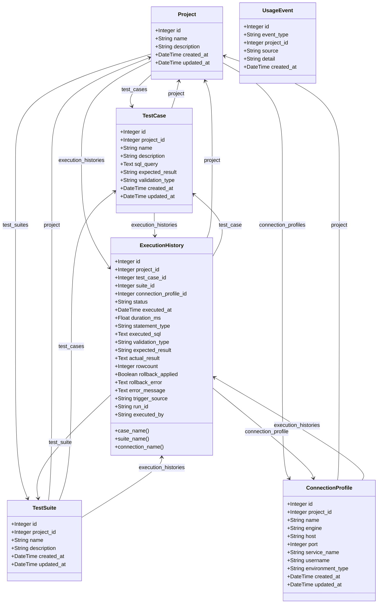
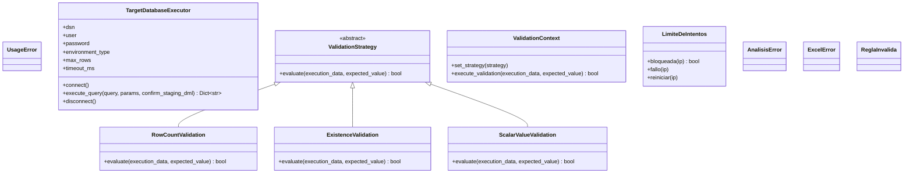
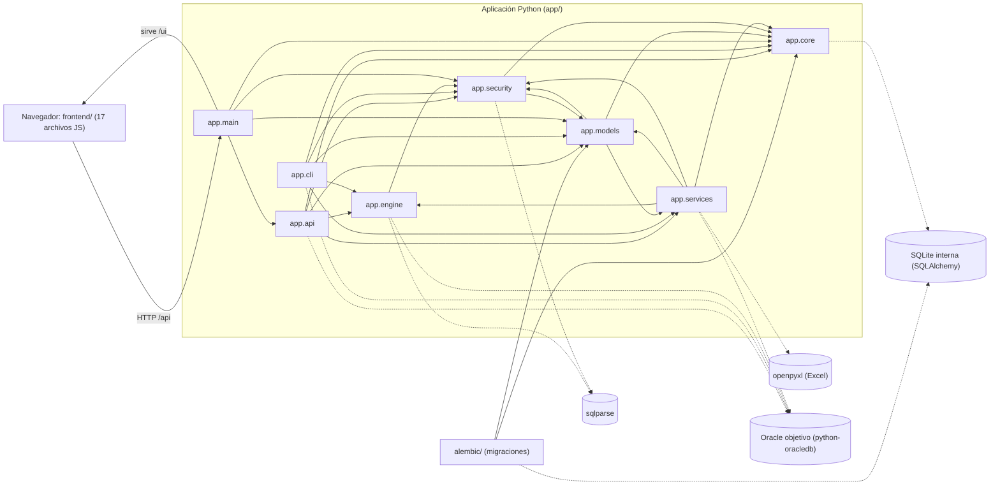
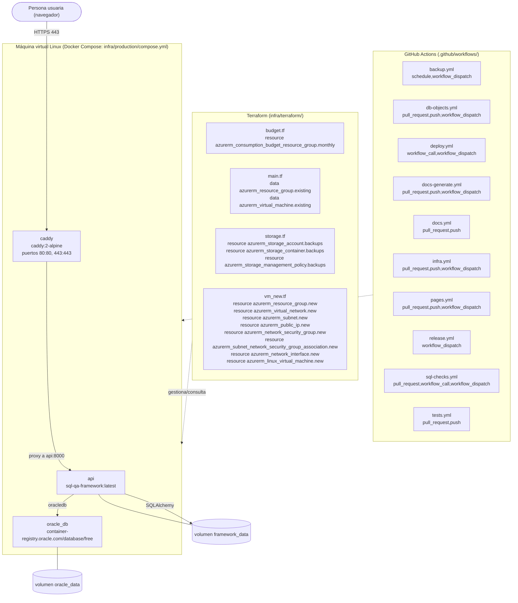

<!-- GENERADO por scripts/docs/gen_docs.py. No editar a mano: edite el código o descripciones_datos.py y vuelva a ejecutarlo. -->

# Diagramas generados

Todos se generan desde el código con `scripts/docs/gen_docs.py`. Los diagramas de casos de uso, actividad, secuencia, paquetes y arquitectura de `docs/diagramas/` se mantienen **a mano** y no se regeneran.

## Modelo entidad-relación de la base interna (SQLite)

## Clases ORM (base interna)

## Clases del motor, la seguridad y los servicios

## Clases Pydantic de la API

```mermaid
%% Clases Pydantic de entrada y salida de la API (app/models/schemas.py)
classDiagram
    class ValidationTypeEnum {
    }
    class EnvironmentTypeEnum {
    }
    class ProjectCreate {
        +str name
        +Optional~str~ description
        +validate_name(v) str
    }
    class ProjectUpdate {
        +Optional~str~ name
        +Optional~str~ description
        +validate_name(v) Optional~str~
    }
    class ProjectResponse {
        +int id
        +datetime created_at
        +datetime updated_at
    }
    class ConnectionProfileCreate {
        +int project_id
        +str name
        +str engine
        +str host
        +int port
        +str service_name
        +str username
        +EnvironmentTypeEnum environment_type
        +validate_non_empty(v) str
        +validate_host(v) str
        +validate_service(v) str
        +validate_engine(v) str
    }
    class ConnectionProfileUpdate {
        +Optional~str~ name
        +Optional~str~ host
        +Optional~int~ port
        +Optional~str~ service_name
        +Optional~str~ username
        +Optional~EnvironmentTypeEnum~ environment_type
        +validate_non_empty(v) Optional~str~
        +validate_host(v) Optional~str~
        +validate_service(v) Optional~str~
    }
    class ConnectionProfileResponse {
        +int id
        +int project_id
        +str name
        +str engine
        +str host
        +int port
        +str service_name
        +str username
        +str environment_type
        +datetime created_at
        +datetime updated_at
    }
    class TestConnectionRequest {
        +str password
    }
    class TestCaseCreate {
        +Optional~int~ project_id
        +str name
        +Optional~str~ description
        +str sql_query
        +Optional~ValidationTypeEnum~ validation_type
        +str expected_result
        +validacion_automatica(data) Any
        +validate_text(v) str
        +validate_expected(v, info) str
    }
    class TestCaseUpdate {
        +Optional~str~ name
        +Optional~str~ description
        +Optional~str~ sql_query
        +Optional~ValidationTypeEnum~ validation_type
        +Optional~str~ expected_result
        +validacion_automatica(data) Any
        +validate_text(v) Optional~str~
    }
    class TestCaseResponse {
        +int id
        +int project_id
    }
    class TestSuiteCreate {
        +Optional~int~ project_id
        +str name
        +Optional~str~ description
        +validate_name(v) str
    }
    class TestSuiteUpdate {
        +Optional~str~ name
        +Optional~str~ description
        +validate_name(v) Optional~str~
    }
    class TestSuiteResponse {
        +int id
        +int project_id
        +List~TestCaseResponse~ test_cases
    }
    class DBCredentials {
        +str password
        +int connection_profile_id
        +Optional~EnvironmentTypeEnum~ environment_type
        +bool confirm_staging_dml
    }
    class ExecutionRequest {
        +str sql_query
    }
    class TestCaseExecutionRequest {
    }
    class SuiteExecutionRequest {
    }
    class ExecutionResponse {
        +bool success
        +str statement_type
        +List~Any~ rows
        +int rowcount
        +List~Any~ data
        +str message
        +Optional~str~ error_message
        +bool rollback_applied
        +Optional~str~ rollback_error
    }
    class QuickExecutionRequest {
        +int connection_profile_id
        +str password
        +str sql_query
        +Optional~ValidationTypeEnum~ validation_type
        +str expected_result
        +Optional~str~ _motivo_auto
        +aceptar_auto(data) Any
        +validate_text(v) str
        +validate_expected_for_type()
        +motivo_validacion_automatica() Optional~str~
    }
    class QuickExecutionResponse {
        +int history_id
        +str status
        +str environment_type
        +str connection_name
        +str sql_query
        +str validation_type
        +str expected_result
        +str expected_text
        +str obtained_text
        +str reason
        +bool validation_auto
        +Optional~str~ validation_reason
        +List~str~ columns
        +Optional~str~ obtained_value
        +List rows
        +int rows_shown
        +bool rows_truncated
        +bool rows_hidden
        +int rowcount
        +float duration_ms
        +Optional~str~ error_message
    }
    class HistoryResponse {
        +int id
        +int project_id
        +Optional~int~ test_case_id
        +Optional~int~ suite_id
        +Optional~int~ connection_profile_id
        +str status
        +datetime executed_at
        +float duration_ms
        +Optional~str~ statement_type
        +str executed_sql
        +Optional~str~ validation_type
        +Optional~str~ expected_result
        +Optional~str~ actual_result
        +int rowcount
        +bool rollback_applied
        +Optional~str~ rollback_error
        +Optional~str~ error_message
        +Optional~str~ trigger_source
        +Optional~str~ run_id
        +Optional~str~ executed_by
        +Optional~str~ case_name
        +Optional~str~ suite_name
        +Optional~str~ connection_name
    }
    class SuiteCaseResult {
        +int history_id
        +int test_case_id
        +str case_name
        +str status
        +Optional~str~ validation_type
        +Optional~str~ expected_result
        +str expected_text
        +str obtained_text
        +str reason
        +float duration_ms
        +Optional~str~ error_message
        +Optional~str~ previous_status
        +Optional~datetime~ previous_executed_at
        +Optional~str~ change
        +Optional~str~ change_text
    }
    class SuiteExecutionSummary {
        +int suite_id
        +str suite_name
        +int total_tests
        +int passed
        +int failed
        +int errors
        +float total_duration_ms
        +Optional~str~ run_id
        +List~HistoryResponse~ details
        +List~SuiteCaseResult~ case_results
        +int new_failures
        +int fixed
    }
    ProjectCreate <|-- ProjectResponse
    TestCaseCreate <|-- TestCaseResponse
    TestSuiteCreate <|-- TestSuiteResponse
    DBCredentials <|-- ExecutionRequest
    DBCredentials <|-- TestCaseExecutionRequest
    DBCredentials <|-- SuiteExecutionRequest
```

## Componentes y dependencias entre paquetes

## Despliegue (compose, Terraform y workflows)

